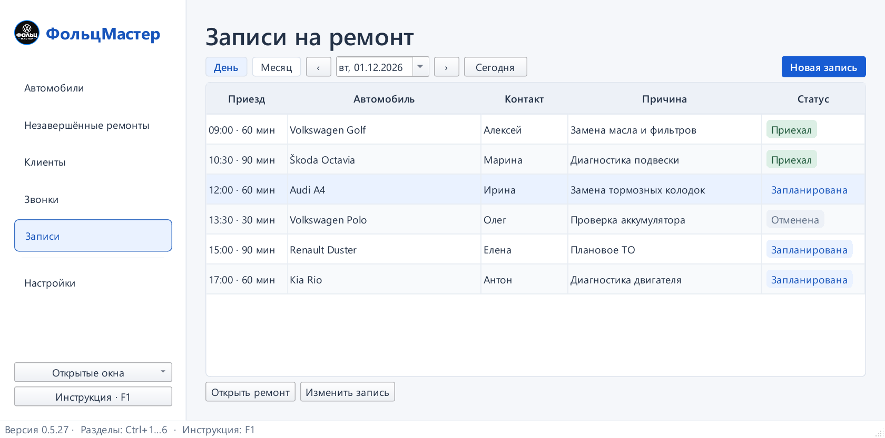

# AutoService

AutoService помогает небольшому автосервису вести запись на ремонт и хранить историю обслуживания каждой машины. Программа работает на одном компьютере с Windows. Данные хранятся локально, поэтому для повседневной работы интернет не нужен.

[Скачать для Windows x64](https://github.com/Lev1313/AutoService/releases/latest) · [Руководство пользователя](docs/OWNER-GUIDE.txt)



*Расписание на вымышленных данных. На снимке показана версия из ветки `main`.*

## Работа в программе

- **Запись на ремонт.** Посмотрите расписание на день или месяц, подберите время, перенесите или отмените визит. Когда автомобиль приедет, откройте ремонт прямо из записи.
- **Клиенты и автомобили.** Найдите машину по госномеру или контакту владельца. В карточке автомобиля собраны пробег, история работ и рекомендации к следующему визиту.
- **Ремонт и документы.** Ведите список незавершённых ремонтов, фиксируйте работы и запчасти. Сервисный лист и заказ-наряд можно сохранить в PDF или распечатать.
- **Плановое обслуживание.** Список звонков подскажет, кого пора пригласить на ТО. После разговора можно записать клиента на выбранную дату.

## Первый запуск

1. На [странице выпуска](https://github.com/Lev1313/AutoService/releases/latest) откройте **Assets** и скачайте ZIP с пометкой `Windows-x64-portable`.
2. Распакуйте архив в отдельную папку и запустите `AutoService.exe`. При первом запуске программа создаст пустую базу.
3. Откройте **Автомобили**, чтобы добавить первую машину, или **Записи**, чтобы запланировать визит. Справка доступна по клавише **F1**.

Резервную копию можно создать и восстановить в разделе **Настройки → Резервные копии**. Она пригодится и при переносе данных на другой компьютер.

## Разработчикам

Приложение написано на Python с интерфейсом на PySide6 и базой SQLite. Для запуска из исходников на Windows потребуется Python 3.13 x64.

```powershell
git clone https://github.com/Lev1313/AutoService.git
cd AutoService
py -3.13 -m venv .venv
.\.venv\Scripts\python.exe -m pip install -r requirements.txt
.\.venv\Scripts\python.exe main.py
```

Проверки кода и тесты запускает `check.bat`. Для работы с расписанием см. [операции с записями](app/services/appointments.py) и [интерфейс календаря](app/ui/appointments.py).

[Архитектура](docs/architecture.md) · [Настройка окружения](docs/environment.md) · [Сборка для Windows](docs/WINDOWS-RELEASE.md)
